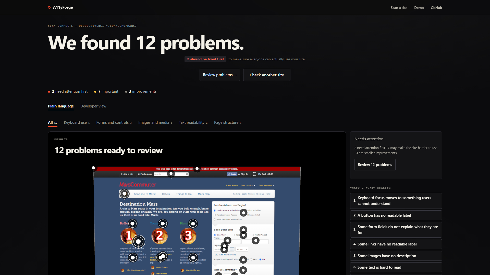
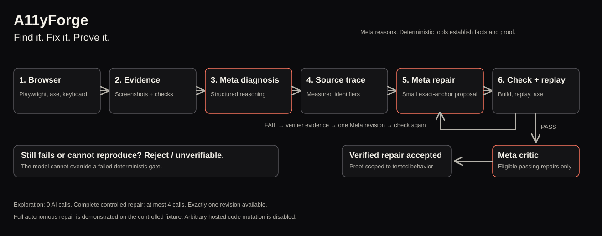
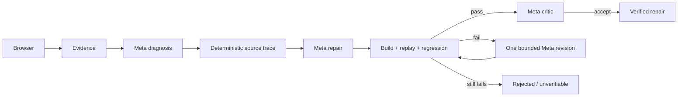

# A11yForge

**Find it. Fix it. Prove it.**

A11yForge observes accessibility failures in a real browser, uses Meta models to propose bounded source repairs, and rejects repairs until deterministic project checks and browser replay pass.

[Recorded repair walkthrough](docs/DEMO_SCRIPT.md) · [Submission copy](docs/SUBMISSION_COPY.md) · [Validation report](docs/FINAL_VALIDATION.md)



## Demo

Run locally, then open [the recorded real repair](http://localhost:3000/console). It uses the committed, sanitized run `2026-10-26T19-04-29-541Z-27affb`; playback makes **zero model calls**.

The first repair improved keyboard behavior but failed strict TypeScript with **TS18048**. A11yForge rejected it. The compiler output became evidence for one bounded revision. The second repair passed typecheck, build, the original keyboard replay, reverse Shift+Tab traversal, and accessibility regression checks before acceptance.

A public deployment URL and narrated video are pending; see [deployment instructions](docs/DEPLOYMENT.md).

## What it does

- Opens public websites with Playwright, runs axe and interaction probes, and captures screenshots and measured element geometry.
- Groups real findings into keyboard, forms, images, readability, and page structure.
- Explains problems in plain language; developer details retain the technical evidence.
- Connects public repository code or a trusted local tree to browser findings through deterministic source matching.
- Runs the complete Meta repair/revision/critic loop against the controlled Broken Shop fixture. Generic source tracing and verification modules exist; arbitrary-source repair execution is not wired into the web UI or CLI.

## Why it is different

The central behavior is **self-rejection with evidence**. A repair that looks better in the browser can still fail the compiler or introduce a regression. A model cannot waive those failures or certify its own change.

## How it works





## Meta models

The implemented runtime defaults to **`muse-spark-1.3-contributor`** at **`https://api.meta.ai/v1/chat/completions`**. The recorded run's four usage artifacts identify that model for diagnosis, proposal, revision, and critic. Requests use fixed JSON schemas, local Zod validation, and evidence-reference checks.

Live fixture orchestration permits **at most four calls**: diagnosis, proposal, an optional revision, and an eligible critic. Standalone diagnosis defaults to one call. Exploration uses zero calls. Invalid model output fails closed; there are no automatic model-output retries.

**Baseten:** no active Baseten path or Baseten environment configuration was found in this checkout. Provider functions accept an injected base URL, but `MODEL_BASE_URL` is not read by the runtime. Baseten is a possible deployment adaptation, not a technology claimed as executed here.

## Architecture

| Workspace | Responsibility |
| --- | --- |
| `apps/web` | Next.js / React interface, Three.js scene, Anime.js motion, HTML/2D equivalents |
| `apps/api` | Fastify routes, SSE, bounded orchestration, artifact delivery |
| `packages/engine` | Playwright / axe evidence, source trace, isolated patches, deterministic verification |
| `packages/meta` | Only model-calling package; schemas, budgets, usage |
| `packages/shared` | Cross-boundary schemas and types |
| `fixtures/broken-shop` | Controlled deliberately broken target |
| `demo/accepted-run` | Sanitized recorded proof, usable without credentials |

## Run locally

Requires Node.js 20+ and pnpm 10.34.9 (declared in `packageManager`).

```sh
pnpm install --frozen-lockfile
pnpm --filter @a11yforge/engine exec playwright install chromium
pnpm build
pnpm start
```

Open [the app](http://localhost:3000); the API listens on port 3001. On Linux, install Playwright system dependencies with `playwright install --with-deps chromium`.

No API key is needed for live website scans or recorded playback. For the controlled live repair, set server-side `MODEL_API_KEY` using [the environment template](.env.example). Set `NEXT_PUBLIC_API_URL` before building if the API runs elsewhere.

```sh
pnpm explore -- --url https://example.com
pnpm --filter @a11yforge/engine repair -- --run <run-id> --finding <finding-id> --source <project-directory>
```

Despite its command name, the generic `repair` CLI currently connects and traces source; it does **not** execute model-backed repair. Full fixture repair commands are listed in the root package scripts. Keep run artifacts on the same machine and point `A11YFORGE_RUNS_DIR` at their location when necessary.

## Safety model

Targets are validated against private, loopback, link-local and reserved addresses, including redirect and DNS checks. Source acquisition enforces path containment, bounded access, and symlink protections. Patch commands run without model-generated shell access. Execution environments strip credentials; accepted-demo exports validate and sanitize artifacts.

The browser, compiler, build, replay and regression gates establish evidence. The critic may reject an otherwise passing repair; it cannot override a failed deterministic gate. A verified repair proves only the tested behavior.

## Limitations

- Arbitrary hosted source mutation is disabled. Generic repair execution is not connected to the public UI or CLI.
- Public exploration covers bounded routes and probes, not complete accessibility conformance. Authentication, CAPTCHA and inaccessible routes can prevent coverage.
- Source matches can be ambiguous or unavailable; missing geometry is disclosed.
- Source connection state and exploration event registries are process-local. Browser refresh works while the API remains running; API restarts may make earlier checks unavailable.
- Exactly one revision is available in the controlled repair workflow.
- Public unauthenticated hosting should leave the model key unset unless access to the paid live fixture endpoint is restricted.

## Hackathon

**Meta Global AI Developer Hackathon · Indie Developer Track · Push the Frontier.**

[Official requirements and unresolved form fields](docs/HACKATHON_COMPLIANCE.md) · [Demo script](docs/DEMO_SCRIPT.md) · [Submission text](docs/SUBMISSION_COPY.md)
