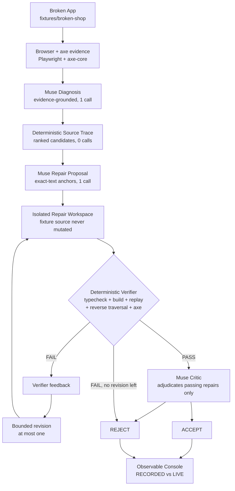

# A11yForge

**Find. Fix. Prove accessibility.**

### Test any website

Paste a URL.

### Repair with source

Connect the repository or run A11yForge locally against your source tree.

Paste a website and A11yForge tests it with a real browser, reproduces accessibility failures, and records exactly what happened.

When source code is connected, A11yForge traces a confirmed failure into the codebase, proposes a repair, and deterministically verifies whether the repair actually worked:

Website
→ Browser evidence
→ Source trace
→ Repair
→ Same failure replayed
→ Verified or rejected

**Testing is framework-independent. Repairs are verified when the connected project can be built and run inside A11yForge's isolated environment.**

## Two layers

**Universal website testing** — paste any website. A11yForge opens it in a real browser, discovers its pages and interaction surfaces from live semantics, runs automated checks and safe keyboard probes, and reports human-readable findings with reproduction evidence. No source code needed, no AI calls involved.

**Source-connected autonomous repair** — with the codebase connected, a confirmed failure is diagnosed, traced to source, patched minimally in an isolated workspace, rebuilt, replayed, and accepted only when deterministic evidence proves the fix. When the evidence does not prove it, A11yForge rejects its own repair.

## What it does

```text
Universal exploration (no source needed, 0 model calls)
  URL → Browser → semantic surface discovery → accessibility probes
    → deterministic evidence → human-readable findings

Optional source repair (source connected)
  Evidence → Diagnose (Meta model, evidence-grounded, 1 call)
  → Trace Source (deterministic, 0 calls)
  → Repair (Meta proposal, exact-text anchors, 1 call)
  → Verify (isolated workspace: typecheck, build, replay, axe regression)
  → Reject or Accept (bounded revision on verifier feedback, then critic)
```

## Why the verifier matters

The strongest moment in the recorded demo is a rejection. Attempt 1's AI-generated focus trap fixed the browser behavior — the replayed scenario stayed inside the modal — but it failed strict TypeScript (`TS18048`: possibly-`undefined` indexing under `noUncheckedIndexedAccess`). The deterministic verifier rejected its own AI-generated repair without spending the critic call. Verifier feedback drove exactly one bounded revision: a two-line `undefined` guard. Attempt 2 then passed typecheck, build, the exact keyboard replay, reverse Shift+Tab traversal, and the 4-rule axe baseline — and only then did the critic accept it (confidence 0.86). An engine that hides its failed repair cannot be trusted with its accepted one, so both attempts are preserved in the console.

## Architecture



- `apps/web` — Next.js console. Renders engine state; runs no repairs.
- `apps/api` — Fastify service. Validates, serves run views and artifacts, orchestrates live runs, exposes `GET /health`.
- `packages/engine` — the autonomous repair loop and all deterministic tooling (scanner, keyboard replayer, tracer, isolated applier, verifier, read model, demo exporter).
- `packages/meta` — the only Meta model caller. Bounded, schema-constrained calls.
- `packages/shared` — cross-boundary Zod schemas and types.
- `fixtures/broken-shop` — the controlled broken target.
- `demo/accepted-run/` — the committed, sanitized, real ACCEPTED run.
- `docs/` — spec, architecture, roadmap.

## Safety / trust model

- **AI proposes. Deterministic systems verify.** Build outcome, replayed assertions, and the axe comparison decide eligibility; any failure rejects without spending the critic call.
- **AI cannot override deterministic failure.** The critic is consulted only on an otherwise passing repair, and a REJECT verdict still rejects.
- **Autonomy is bounded.** At most 4 model calls per live run (diagnosis, proposal, at most one revision, critic if eligible). No open-ended agents, no models with shell access, no unbounded retries.
- **Minimum safe patches.** Exact-text anchors, at most 2 files / 4 edits, confined paths. The fixture source is never mutated — repairs land in isolated workspaces retained as artifacts.
- **Recorded is never live.** The bundled demo is labeled `RECORDED` everywhere; nothing replays historical events pretending they are newly executing.

## Meta technology

| Where | Model | Job |
|---|---|---|
| Development | Muse Code | Built this repository |
| Diagnosis | Muse Spark 1.3 | Evidence-grounded structured diagnosis (1 call) |
| Repair proposal | Muse Spark 1.3 | Exact-anchor patch proposal (1 call) |
| Bounded revision | Muse Spark 1.3 | Verifier-feedback-grounded fix-forward (at most 1) |
| Critic | Muse Spark 1.3 | Accept/reject verdict on passing repairs only |

No other Meta functionality is used or claimed.

## Demo

**No API key needed.** Clone, install, build, start — the console lands on a real previously completed ACCEPTED run bundled with the checkout:

```sh
pnpm install
pnpm build
pnpm start
```

Open [http://localhost:3000](http://localhost:3000): paste any website to test it with a real browser. The **Try the demo** link opens the recorded repair run — pipeline, focus evidence, before/after screenshots, diagnosis, source trace, both diffs, deterministic gates, and the critic verdict under a `RECORDED` badge.

Developers can run the same universal engine from the terminal:

```sh
pnpm explore -- --url https://example.com [--max-pages 3]
```

Developers can connect source and trace a finding from the terminal:

```sh
pnpm --filter @a11yforge/engine repair -- --run <run-id> --finding <finding-id> --source .
pnpm --filter @a11yforge/engine repair -- --run <run-id> --finding <finding-id> --git https://github.com/owner/repo
```

Untrusted repository code builds and runs only in isolation (Docker when available; hosted deployments can require it with `A11YFORGE_REQUIRE_DOCKER=true`). `MODEL_API_KEY` and credentials never enter the sandbox.

Local targets need an explicit opt-in (`A11YFORGE_ALLOW_PRIVATE_TARGETS=true`); see [.env.example](.env.example). Never enable it on an untrusted public deployment.

**Live run (optional).** With `MODEL_API_KEY` exported on the API server, **Start Autonomous Repair** executes the real pipeline against Broken Shop and streams its events (at most 4 Meta calls; usage shown afterwards, no cost computed). Without the key, the console says so explicitly — `Live Meta execution unavailable — MODEL_API_KEY not configured` — and the recorded run stays fully inspectable.

```sh
pnpm demo:validate   # verify the committed bundle (schemas, evidence, sanitization)
pnpm demo:export -- --run <run-id>   # re-export one explicitly named ACCEPTED run
```

## Local setup

Requires Node.js ≥ 20 and pnpm 10.

```sh
pnpm install
pnpm build
pnpm dev        # web on :3000, API on :3001 (development)
pnpm start      # web + API in production mode (after build)
```

Configuration (see [.env.example](.env.example); never commit real values):

| Variable | Purpose | Default |
|---|---|---|
| `MODEL_API_KEY` | Live Meta model calls (server-side only) | unset → recorded mode only |
| `PORT` / `HOST` | API listen address | `3001` / `127.0.0.1` |
| `NEXT_PUBLIC_API_URL` | API base the browser calls (build-time) | `http://127.0.0.1:3001` |
| `A11YFORGE_DATA_DIR` | Writable runtime root (production) | working tree |
| `A11YFORGE_RUNS_DIR` | Live-run artifact dir override | `<data-dir>/.a11yforge/runs` |
| `A11YFORGE_CORS_ORIGIN` | API CORS origin | `*` |
| `A11YFORGE_VERSION` | Release label in `/health` | `0.7.0` |

`GET /health` reports `status`, `service`, `version`, `modelConfigured`, `demoMode`, and `dataDirWritable` — booleans and labels only, never keys, paths, or environment values.

## Container

```sh
docker build -t a11yforge .
docker run --rm -p 3000:3000 -p 3001:3001 a11yforge
```

The image pins Node 20, installs the workspace, builds it, provisions Playwright Chromium, and runs web + API as a non-root user with a writable `/data/a11yforge` volume. No `MODEL_API_KEY` is baked in — pass it at runtime only when live runs are wanted:

```sh
docker run --rm -p 3000:3000 -p 3001:3001 -e MODEL_API_KEY="$MODEL_API_KEY" a11yforge
```

## Tests

Suites run with zero live model calls (deterministic fixtures and synthesized artifacts only):

- Engine: scanner normalization, keyboard runner and assertions, diagnosis/trace/proposal validation, isolated workspace safety, verifier gates, revision safety, read-model projection, demo-bundle sanitizer/validator, plus universal exploration (URL safety, surface discovery, probe applicability, findings projection, and an anti-fixture-coupling source scan).
- API: run routes and artifact allow-listing, live-run orchestration with a mock pipeline, exploration routes with a stubbed engine (validation, cancel, SSE ordering, artifact allow-listing, honest failures), and deployment behavior (data-dir resolution, recorded fallback, safe health, missing-key refusal, traversal rejection).
- Fixture and console: strict typecheck, lint, and an axe-clean UI. The controlled broken target (`fixtures/broken-shop`) is test infrastructure for the repair loop — production explorer code carries zero knowledge of it, enforced by an automated source scan.

```sh
pnpm typecheck
pnpm lint
pnpm test:engine
pnpm --filter @a11yforge/api test
```

## Hackathon scope

This repository was built during the Meta Global AI Developer Hackathon. The autonomous repair loop (scan → evidence → diagnose → trace → repair → verify → revise → critic) is complete and feature-frozen; this phase hardened it for demo and deployment: a committed recorded ACCEPTED run, production startup, container packaging, and judge-ready documentation. No new AI capabilities were added.
