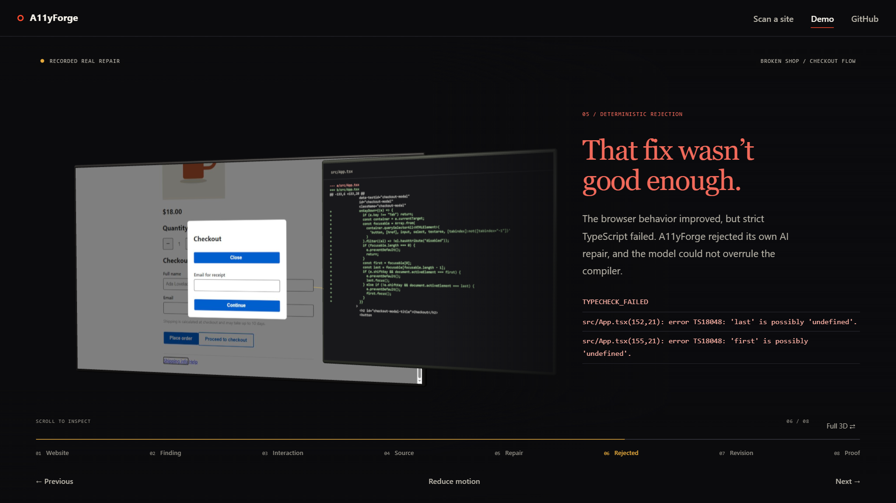
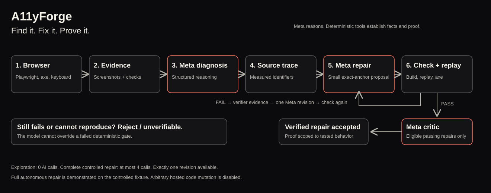

# A11yForge

A11yForge observes accessibility failures in a real browser, uses Meta models to reason about bounded repairs, and refuses to call a fix successful until deterministic replay verifies it.

**Find it. Fix it. Prove it.**

[Demo video](https://cdn.jsdelivr.net/gh/Amirtheshwaran/a11yforge@513704cecfe59f075cdd52f5429354c8f3bc7011/submission-assets/video/a11yforge-demo.mp4) · [Run locally](#run-locally) · [What is live and what is recorded](#what-is-live-and-what-is-recorded) · [Built during the hackathon](#built-during-the-hackathon) · [Limitations](#limitations)



**Public deployment:** https://unelected-unearned-average.ngrok-free.dev — key-less, smoke-tested 2 November 2026. See [deployment status](docs/DEPLOYMENT.md).

## Why it matters

Accessibility bugs usually reach developers as reports, detached from the code and from the interaction that failed. A patch that looks right can still break the build or leave the failure in place. A11yForge shortens the loop for the developers and teams who have to fix these bugs:

```text
user-visible failure → evidence → implementation → attempted repair → proof
```

A repair is trusted only because it was checked, not because a model said so.

## The story it proves

In one real recorded run against a controlled target:

1. Keyboard focus escaped an open checkout dialog. A real browser reproduced it.
2. A Meta model diagnosed the failure from that evidence, and proposed a bounded edit to the traced source.
3. The browser behavior improved: focus stayed in the dialog.
4. Strict TypeScript still failed: `error TS18048: 'last' is possibly 'undefined'.`
5. A11yForge **rejected its own AI repair**.
6. The compiler output became evidence for exactly one bounded revision.
7. The revision passed typecheck and build. The original interaction was replayed, reverse Shift+Tab was checked, and accessibility regressions were checked.
8. Only then was it accepted.

## Meta's role

**Meta reasons. Tools verify.** Every call is made from [`packages/meta`](packages/meta), the only model-calling package. The default provider configuration is `https://api.meta.ai/v1` with `muse-spark-1.3-contributor`. A11yForge also supports a configurable OpenAI-compatible model base URL through `MODEL_BASE_URL`.

| Call | Purpose | Input evidence | Structured output |
| --- | --- | --- | --- |
| Diagnosis | Explain the observed failure | Browser evidence bundle: scan, keyboard trace, failed assertion | Issue type, likely cause, repair strategy, evidence IDs, WCAG criteria |
| Repair proposal | Propose the smallest fix | The diagnosis and the deterministically traced source | Exact edits (`originalText`, `replacementText`), rationale, risks, verification plan |
| Revision (at most one) | Repair the repair | The compiler or verifier output, plus the original edit and evidence | Same schema as a proposal |
| Critic (only if the gates pass) | Challenge a passing repair | The gate results and evidence | Accept or reject, remaining risks, verification concerns |

Requests use `response_format` with strict JSON schemas, and replies are validated locally with Zod and checked against the supplied evidence IDs. A diagnosis's `issueType` is also checked against the deterministic failed assertion, so a focus escape labelled `contrast` is rejected. Invalid output fails closed with no automatic retry. The complete run is capped at **four calls**, enforced in [`pipeline.ts`](packages/engine/src/autorun/pipeline.ts), and each stage runs at most once. Exploration and recorded playback make **zero** calls.

The model may reason, diagnose, propose, revise and critique. It cannot invent browser or source facts, waive a failed gate, or certify its own repair.

The recorded run's real usage:

| Role | Model | Input tokens | Output tokens | Reasoning tokens |
| --- | --- | ---: | ---: | ---: |
| Diagnosis | `muse-spark-1.3-contributor` | 952 | 880 | 601 |
| Repair proposal | `muse-spark-1.3-contributor` | 1738 | 1565 | 919 |
| Revision | `muse-spark-1.3-contributor` | 3163 | 1406 | 727 |
| Critic | `muse-spark-1.3-contributor` | 1078 | 1055 | 916 |

These numbers come from the run's committed [usage artifacts](demo/accepted-run/2026-10-26T19-04-29-541Z-27affb/model-usage-summary.json).

### Two separate pieces of model evidence

| | Recorded full repair run | Fresh live verification |
| --- | --- | --- |
| Date | 26 October 2026 | 1 November 2026 |
| Model | `muse-spark-1.3-contributor` | `meta-models/muse-spark-open-1026`, Baseten-hosted Meta Muse Spark Open |
| What it covers | Diagnosis, proposal, bounded revision and critic, as recorded artifacts | **Diagnosis only**, through A11yForge's real diagnosis path with fresh real-browser evidence |
| Result | Repair accepted after the deterministic gates passed | Valid structured diagnosis, with the provider request ID captured |
| Artifacts | [Recorded run](demo/accepted-run/2026-10-26T19-04-29-541Z-27affb) | [Verification run](submission-assets/live-verification-2026-11-01) |

Limits of the 1 November verification:

- Proposal, revision and critic were not freshly verified through Baseten. No repair loop ran through Baseten, on the controlled target or on any other site.
- Schema validation checks structure, not correctness. The diagnosis described the focus escape correctly, but its `issueType` field said `contrast` instead of `focus-containment`. A11yForge now rejects that contradiction deterministically ([`provider.ts`](packages/meta/src/provider.ts)); the diagnosis prompt also defines each label. Neither change has been re-verified against a live model yet.
- The default `api.meta.ai` endpoint was not re-verified that day, because the available key is not valid there.

## What is deterministic

These establish the facts, and no model can overrule them: Playwright, axe-core, keyboard and form probes, source tracing, the TypeScript compiler, the build, interaction replay and accessibility regression gates.



## What is live and what is recorded

| Capability | Status | Scope |
| --- | --- | --- |
| Website scan | **Live** on any publicly reachable site | Bounded crawl: 3 pages, 8 screenshots and 120 seconds by default. Zero model calls. |
| Spatial tour of findings | **Live** | Rendered from that scan's screenshots and measured geometry. |
| Source inspection | **Live** for public repositories and trusted local source | Ranked candidates. Ambiguous and missing matches stay explicit. |
| Repair loop | **Recorded real run** in the app, run `2026-10-26T19-04-29-541Z-27affb` | Controlled Broken Shop target only. Can be run live locally with a model key. |
| Repair of an arbitrary website | **Not available** | Not connected to the UI, API or CLI. See [limitations](#limitations). |

## See the demo

- Watch [the 2:45 video](https://cdn.jsdelivr.net/gh/Amirtheshwaran/a11yforge@513704cecfe59f075cdd52f5429354c8f3bc7011/submission-assets/video/a11yforge-demo.mp4) ([transcript](submission-assets/video/a11yforge-demo-transcript.md)). GitHub's file view won't play it, so this link serves the committed file from a public CDN.
- Or run the app and open `/console` for the recorded repair, which needs no key.

## Run locally

Use **Node.js 22.18+** and **pnpm 10.34.9**.

```sh
git clone https://github.com/Amirtheshwaran/a11yforge.git
cd a11yforge
pnpm install --frozen-lockfile
pnpm --filter @a11yforge/engine exec playwright install chromium
pnpm build
pnpm start
```

Open [localhost:3000](http://localhost:3000). The API listens on port 3001. Scans and the recorded demo need no key.

For a live repair of the controlled target, set `MODEL_API_KEY` in a local `.env` using [the template](.env.example). A full run makes up to four paid calls. For another OpenAI-compatible host, also set `MODEL_BASE_URL` and `A11YFORGE_META_MODEL`. The fixture commands are in the root `package.json`.

Other commands: `pnpm explore -- --url https://example.com --max-pages 3` scans from the CLI, and `pnpm --filter @a11yforge/engine repair -- --run <run-id> --finding <finding-id> --source <dir>` traces a finding into source. Despite its name, that last command inspects source only and exits with code 3.

## Built during the hackathon

Everything below was built during the Meta Global AI Developer Hackathon, from 26 October 2026. The [new-work audit](docs/HACKATHON_NEW_WORK.md) lists the commits, dates and files, and one timing caveat about the first scaffold commit.

- Real-browser accessibility exploration
- Evidence provenance
- Spatial 3D issue tours
- Meta-powered bounded repair reasoning: diagnosis, proposal, revision and critic
- Deterministic self-rejection and revision
- Source inspection
- The recorded verification workflow

A11yForge is a solo Indie Developer track project by Amirtheshwaran Navaneethakrishnan. Open-source dependencies are reused under their licenses and not claimed as new work. Details are in the audit.

## Architecture

| Workspace | Responsibility |
| --- | --- |
| `apps/web` | Next.js interface, Three.js scene, lightweight fallback |
| `apps/api` | Fastify routes, SSE, bounded orchestration, artifact delivery |
| `packages/engine` | Playwright and axe evidence, source trace, isolated patches, deterministic verification |
| `packages/meta` | The only model caller: schemas, budgets, usage |
| `packages/shared` | Cross-boundary schemas and types |
| `fixtures/broken-shop` | Controlled, deliberately broken target |
| `demo/accepted-run` | Recorded proof, usable without credentials |

Commands: `pnpm build`, `pnpm typecheck`, `pnpm lint`, `pnpm test:engine`, `pnpm test:meta`, `pnpm --filter @a11yforge/web test`, `pnpm --filter @a11yforge/api test`, `pnpm demo:validate`. [CI](.github/workflows/ci.yml) runs all of them and smoke-tests both container images.

## Safety

Website and Git targets are refused if they resolve to private, loopback, link-local or reserved addresses, including across website redirects. Git redirects are not followed. Source clones are shallow with hooks disabled, and connecting a repository runs none of its code. Patch commands never come from a model. Execution environments strip credentials. Keys stay server-side, and the browser never receives them.

A verified repair proves the tested behavior, not whole-site conformance.

## Limitations

- **Repair of arbitrary websites is not available.** The live repair loop targets the controlled fixture. Running a stranger's repository safely needs a Docker sandbox that a public host cannot provide here, so it was deliberately not connected.
- **The repair shown in the app and the video is recorded**, not live.
- **Coverage is bounded.** Authentication, CAPTCHA, bot protection and blocked or missing pages can prevent testing, and those pages are reported as untested. A scan is not a conformance audit.
- **Source matches can be ambiguous or missing**, and then no cause is claimed. Measured locations can also be unavailable, and then none is drawn.
- **Live runs on a hosted deployment need an operator passcode.** `POST /runs` has no user accounts; with a key set, protect it with `A11YFORGE_RUN_PASSCODE`. Per-client hourly limits and a global daily run cap apply either way, and are held in memory. See [deployment](docs/DEPLOYMENT.md#security-on-a-public-host).
- **Scan results are readable by anyone with their URL.** In-progress streams and source connections live in one server process.
- **Testing used browser viewports and simulated conditions.** Physical iOS and Android devices have not been tested.

## Further reading

[Hackathon compliance](docs/HACKATHON_COMPLIANCE.md) · [New-work audit](docs/HACKATHON_NEW_WORK.md) · [Implementation status](docs/IMPLEMENTATION_STATUS.md) · [Evidence integrity](docs/evidence-integrity.md) · [Architecture](docs/ARCHITECTURE.md) · [Spatial tour](docs/spatial-tour.md) · [Deployment](docs/DEPLOYMENT.md) · [Demo script](docs/DEMO_SCRIPT.md) · [Asset provenance](submission-assets/README.md)

**Meta Global AI Developer Hackathon · Indie Developer track · Push the Frontier**
