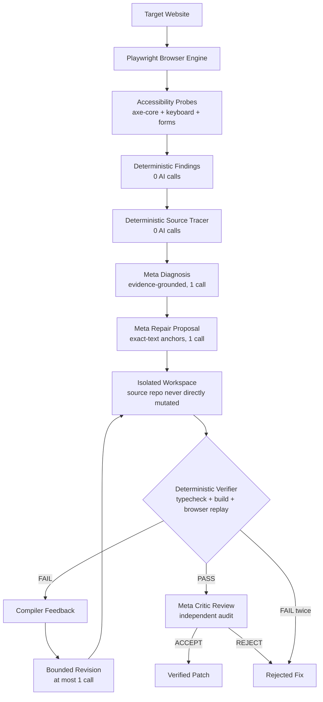

# A11yForge

> **“Give me a website. I’ll show you exactly where people may have trouble using it, explain why, and help fix it.”**

A11yForge is an autonomous accessibility engineering platform for the **Meta Global AI Developer Hackathon** (Indie Developer Track — *Push the Frontier*). It gives machines the ability to inspect real web interfaces in a browser, observe accessibility failures, trace problems to responsible source code, propose bounded repairs, deterministically verify them in an isolated workspace, and reject repairs that fail project checks.

---

## Demo (No API Key Required)

Judges can explore the full product immediately without configuring keys or incurring API spend:

```sh
pnpm install
pnpm build
pnpm start
```

1. Open **[http://localhost:3000](http://localhost:3000)** to test any website in a live browser.
2. Click **Try the demo** (or visit `http://localhost:3000/console`) to watch a recorded, verified repair from end to end.

### The Key Demo Moment: Self-Rejection
In the recorded demo, A11yForge **rejects its own first fix**. 
- Attempt 1 resolved the browser focus escape, but failed strict TypeScript compilation (`TS18048`).
- The deterministic compiler gate immediately rejected the repair.
- A11yForge used the compiler failure as feedback for **one careful revision**.
- Attempt 2 passed typecheck, build, browser replay, reverse Shift+Tab traversal, and axe regression checks before being accepted.

---

## How It Works

```text
1. START        Enter any website URL.
   ↓
2. SCAN         A11yForge opens the site in a real browser, maps interaction surfaces,
                and runs deterministic accessibility probes (0 AI model calls).
   ↓
3. UNDERSTAND   See exactly where people have trouble using the site, clustered by category
                (Keyboard, Forms, Images, Readability), with "Show me" element focus.
   ↓
4. FIX          Connect source code (or run locally) to pinpoint the exact file and line.
                Meta model synthesizes an anchored patch in an isolated workspace.
   ↓
5. PROVE        Project builds, replays the original interaction in Playwright, and checks
                axe-core regressions. If any check fails, the fix is rejected.
```

---

## Why It Is Different

| Traditional A11y Scanners | Prompt Wrappers / Copilots | A11yForge |
| :--- | :--- | :--- |
| Produces a 50-page PDF checklist of violations. | Guesses code changes without checking whether they compile. | Traces defects directly from browser measurements to source code. |
| Cannot verify whether any recommendation works. | Asks the LLM if its own fix worked (hallucinated certification). | **Deterministic verifier gates**: Build + Playwright replay + axe regression. |
| Leaves implementation entirely to developers. | Overwrites files directly with zero safety boundary. | Isolated repair workspace; AI is **never** permitted to certify its own work. |
| Silent on regressions. | Unaware of project build systems. | **Self-rejecting**: Rejects bad fixes and uses failures for bounded revisions. |

---

## Meta Technology

A11yForge integrates Meta models via an OpenAI-compatible Chat Completions API with strict JSON schema constrained decoding:

| Role | Model | Endpoint | Responsibility |
| :--- | :--- | :--- | :--- |
| **Diagnosis** | `muse-spark-1.3-contributor` | `https://api.meta.ai/v1` | Evidence-grounded structured diagnosis (1 call) |
| **Repair Proposal** | `muse-spark-1.3-contributor` | `https://api.meta.ai/v1` | Exact-anchor minimal patch proposal (1 call) |
| **Bounded Revision** | `muse-spark-1.3-contributor` | `https://api.meta.ai/v1` | Verifier-feedback-grounded revision (at most 1 call) |
| **Adversarial Critic** | `muse-spark-1.3-contributor` | `https://api.meta.ai/v1` | Independent evaluation of passing repairs (1 call) |

> **Baseten Integration Status**: Baseten is configured in the project environment and documentation as an alternative open-weights inference host. However, the active production runtime path routes directly to the Meta Chat Completions API. We do not claim active Baseten runtime execution or inject unused calls.

---

## Architecture



### Package Structure
- `apps/web` — Next.js 15 continuous spatial console (Stitch design, Three.js inspection showroom, 2D fallback, zero CDN reliance).
- `apps/api` — Fastify service for live exploration, SSE event streaming, and artifact retrieval.
- `packages/engine` — Core engine: Playwright crawler, accessibility probes, source tracer, isolated workspace applier, and deterministic verifier.
- `packages/meta` — Meta model client with token budgeting, Zod wire schemas, and operation tracking.
- `packages/shared` — Shared schemas and type contracts across API, engine, and web.
- `fixtures/broken-shop` — Deliberately defective accessibility fixture for test automation.
- `demo/accepted-run` — Committed, sanitized real run artifacts powering the zero-config demo theatre.

---

## Run Locally

### Requirements
- Node.js ≥ 20
- pnpm 10

### Quickstart
```sh
pnpm install
pnpm build
pnpm start
```
- Web console: `http://localhost:3000`
- API server: `http://localhost:3001`

### CLI Exploration
Run a scan directly from your terminal:
```sh
pnpm explore -- --url https://example.com
```

### Local Repair
Trace and repair a finding against a local repository:
```sh
pnpm --filter @a11yforge/engine repair -- --run <run-id> --finding <finding-id> --source .
```

---

## Safety & Trust Model

1. **AI Proposes, Deterministic Systems Decide**: TypeScript compiler errors, Playwright interaction assertions, and axe-core regressions decide whether a fix passes. The LLM cannot override build or test failures.
2. **Strict Call Budgets**: Hard-capped at 4 model calls per run (diagnosis, proposal, at most one revision, critic). No runaway loops or uncontrolled credit consumption.
3. **Isolated Workspaces**: Repository code is copied into isolated temporary workspaces. Source repositories are never modified directly until a patch is approved.
4. **SSRF & Network Guards**: Explorer validates target URLs, blocks loopback/private IP addresses (RFC 1918), checks DNS rebinding, and denies credentials in URLs.
5. **Secret Isolation**: `MODEL_API_KEY` never enters the build environment or client artifacts. All exported bundles are run through `sanitizeJsonArtifact` and `sanitizeTextArtifact`.

---

## Limitations

- **Online Hosted Repair**: Arbitrary online code modification from the hosted web UI is intentionally disabled to protect production repositories. Users connect code to locate the problem, then run verified repairs locally via the CLI.
- **Dynamic Authentication**: Universal exploration tests public and pre-authenticated routes; multi-step CAPTCHA or external SSO flows must be scanned using local Playwright profiles.
- **Single Bounded Revision**: To prevent looping hallucination, A11yForge allows exactly one compiler-grounded revision attempt. If attempt 2 does not compile or pass tests, the issue is marked as requiring manual developer attention.
