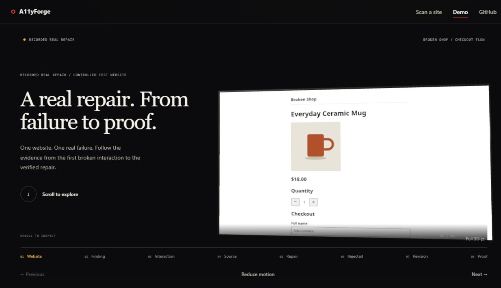
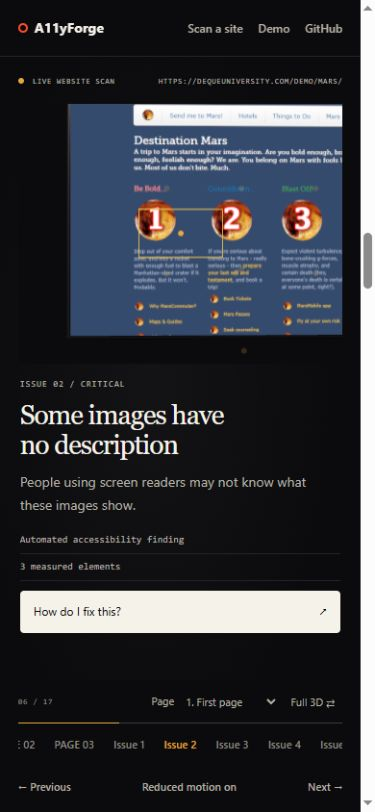
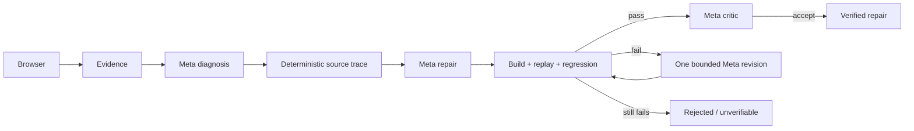

# A11yForge

### See where your website is hard to use.

**Find it. Fix it. Prove it.**

A11yForge finds accessibility problems in a real browser and turns the evidence into a guided 3D walkthrough. Inspect measured issue locations, follow broken keyboard interactions, and trace supported repairs from failure to proof.

[Quick start](#run-locally) · [Capabilities](#what-it-does) · [Architecture](#architecture) · [Development](#development) · [Deployment](docs/DEPLOYMENT.md)



**Live website exploration and the recorded demo work without a model API key.**

## Demo

Run locally, then open [the recorded real repair](http://localhost:3000/console). It uses the committed, sanitized run `2026-10-26T19-04-29-541Z-27affb`; playback makes **zero model calls**.

The first repair improved keyboard behavior but failed strict TypeScript with **TS18048**. A11yForge rejected it. The compiler output became evidence for one bounded revision. The second repair passed typecheck, build, the original keyboard replay, reverse Shift+Tab traversal, and accessibility regression checks before acceptance.

The demo is bundled with the app, so you can inspect both repair attempts and their original evidence without making model calls. See the [walkthrough](docs/DEMO_SCRIPT.md) and [spatial replay provenance](apps/web/public/demo/spatial-replay/README.md).

## What it does

| Workflow | What happens | Current scope |
| --- | --- | --- |
| **Check a website** | Playwright opens the URL, runs axe and interaction checks, and records evidence. | Publicly reachable pages within configured page, time, and screenshot budgets. |
| **Explore the findings** | Scroll through the captured website, zoom into measured issue locations, and read plain-language explanations. | Full and lightweight 3D, captured-page selection, and reduced motion. |
| **Inspect the source** | Connect a public repository or a trusted local project and trace a selected finding into candidate source. | Deterministic source matching; ambiguous and missing matches stay explicit. |
| **Watch a verified repair** | Follow a real failed patch, its rejection, a revision, and the passing verification evidence. | Bundled recorded repair of the controlled Broken Shop fixture. |
| **Run the live repair loop** | Meta models propose bounded changes; project checks and browser replay determine acceptance. | Controlled fixture workflow; requires a server-side model API key. |

### A spatial tour of real evidence

The website stays in one inspection scene while the camera follows the story. Issue boundaries come from measured browser geometry, and recorded focus paths show where keyboard interactions go wrong.

- Capture pages before scanning, so scanner failures can still leave a usable website view.
- Select captured pages, including visible sign-in and HTTP error pages.
- Keep explanations readable when scrolling pauses between chapters.
- Inspect source and return to the same selected finding.
- Use responsive phone, tablet, landscape, and desktop layouts with touch-sized controls.
- Switch to lightweight 3D when WebGL is unavailable or a simpler renderer is preferred.

<p align="center">
  
</p>

<p align="center"><em>Mobile view of a real public-site scan. The desktop preview above shows the separately recorded repair demo.</em></p>

## Why it is different

The central behavior is **self-rejection with evidence**. A repair that looks better in the browser can still fail the compiler or introduce a regression. A model cannot waive those failures or certify its own change.

## How it works




## Meta models

The implemented runtime defaults to **`muse-spark-1.3-contributor`** at **`https://api.meta.ai/v1/chat/completions`**. The recorded run's four usage artifacts identify that model for diagnosis, proposal, revision, and critic. Requests use fixed JSON schemas, local Zod validation, and evidence-reference checks.

Live fixture orchestration permits **at most four calls**: diagnosis, proposal, an optional revision, and an eligible critic. Standalone diagnosis defaults to one call. Exploration uses zero calls. Invalid model output fails closed; there are no automatic model-output retries.

## Architecture

| Workspace | Responsibility |
| --- | --- |
| `apps/web` | Next.js / React interface, Three.js scene, Anime.js motion, lightweight spatial rendering |
| `apps/api` | Fastify routes, SSE, bounded orchestration, artifact delivery |
| `packages/engine` | Playwright / axe evidence, source trace, isolated patches, deterministic verification |
| `packages/meta` | Only model-calling package; schemas, budgets, usage |
| `packages/shared` | Cross-boundary schemas and types |
| `fixtures/broken-shop` | Controlled deliberately broken target |
| `demo/accepted-run` | Sanitized recorded proof, usable without credentials |

## Run locally

Use **Node.js 22.18+** and **pnpm 10.34.9** (declared in `packageManager`). Web tests import TypeScript directly through [Node’s native TypeScript support](https://nodejs.org/en/learn/typescript/run-natively).

```sh
git clone https://github.com/Amirtheshwaran/a11yforge.git
cd a11yforge

pnpm install --frozen-lockfile
pnpm --filter @a11yforge/engine exec playwright install chromium
pnpm build
pnpm start
```

Open **[the app](http://localhost:3000)**. The API listens on **[port 3001](http://127.0.0.1:3001)**, with a health endpoint at `/health`.

On Linux, install Chromium’s system dependencies if needed:

```sh
pnpm --filter @a11yforge/engine exec playwright install --with-deps chromium
```

### Try it

1. Open the landing page to see the product’s capabilities and enter a website URL.
2. Open **[the demo](http://localhost:3000/console)** to follow the recorded repair from failure to proof.
3. Check a publicly reachable website. A bare address such as `example.com` is normalized to HTTPS.
4. Scroll through the findings, select captured pages, and open **How do I fix this?** to inspect source.

By default, exploration visits up to **3 pages**, retains up to **8 screenshots**, and uses a **120-second** run budget. A page capture does not mean every interaction on that page was tested.

No API key is needed for live website scans or recorded playback. For the controlled live repair, set server-side `MODEL_API_KEY` using [the environment template](.env.example). Set `NEXT_PUBLIC_API_URL` before building if the API runs elsewhere.

```sh
pnpm explore -- --url https://example.com --max-pages 3
pnpm --filter @a11yforge/engine repair -- --run <run-id> --finding <finding-id> --source <project-directory>
```

Despite its command name, the generic `repair` CLI currently connects and traces source; it does **not** execute model-backed repair. Full fixture repair commands are listed in the root package scripts. Keep run artifacts on the same machine and point `A11YFORGE_RUNS_DIR` at their location when necessary.

## Configuration

Copy [`.env.example`](.env.example) to a local `.env` file when configuration is needed. Keep credentials server-side and out of Git.

| Variable | Purpose |
| --- | --- |
| `MODEL_API_KEY` | Enables model-backed live fixture repair. Leave unset for website exploration and recorded playback. |
| `A11YFORGE_META_MODEL` | Overrides the default Meta model. |
| `NEXT_PUBLIC_API_URL` | API address used by the browser. Set **before building** when the API uses a different address. |
| `PORT` / `HOST` | API bind address; defaults to port `3001` on `127.0.0.1`. |
| `A11YFORGE_DATA_DIR` | Writable runtime root for production artifacts and workspaces. |
| `A11YFORGE_RUNS_DIR` | Optional override for the live-run artifact directory. |
| `A11YFORGE_CORS_ORIGIN` | Browser origin allowed to access the API. |
| `A11YFORGE_ALLOW_PRIVATE_TARGETS` | Local development override for private/loopback targets. Leave disabled on public hosts. |

For persistent storage, HTTPS ingress, and model-endpoint access controls, follow the [deployment guide](docs/DEPLOYMENT.md).

## Development

After the initial workspace build, start the web and API development servers:

```sh
pnpm dev
```

| Command | Purpose |
| --- | --- |
| `pnpm build` | Build all workspaces. |
| `pnpm typecheck` | Run strict TypeScript checks throughout the repository. |
| `pnpm lint` | Run repository-wide ESLint. |
| `pnpm --filter @a11yforge/web test` | Run web tests, including evidence mapping, motion timing, and URL normalization. |
| `pnpm test:engine` | Build and test the deterministic engine. |
| `pnpm test:meta` | Test the model integration package. |
| `pnpm --filter @a11yforge/api test` | Build and test API routes. |
| `pnpm fixture:dev` | Start the controlled broken target. |

Contributions should preserve strict TypeScript, attach deterministic evidence to findings, keep repairs small, and verify changes before accepting them. See [the engineering rules](AGENTS.md).

## Safety model

Targets are validated against private, loopback, link-local and reserved addresses, including redirect and DNS checks. Source acquisition enforces path containment, bounded access, and symlink protections. Patch commands run without model-generated shell access. Execution environments strip credentials; accepted-demo exports validate and sanitize artifacts.

The browser, compiler, build, replay and regression gates establish evidence. The critic may reject an otherwise passing repair; it cannot override a failed deterministic gate. A verified repair proves only the tested behavior.

## Limitations

- Arbitrary hosted source mutation is disabled. Generic repair execution is not connected to the public UI or CLI.
- Public exploration covers bounded routes and probes, not complete accessibility conformance. Authentication, CAPTCHA and inaccessible routes can prevent coverage.
- Source matches can be ambiguous or unavailable; missing geometry is disclosed.
- Completed scans can be restored from validated saved artifacts after an API restart. Active event streams and source-connection state are process-local.
- Exactly one revision is available in the controlled repair workflow.
- Public unauthenticated hosting should leave the model key unset unless access to the paid live fixture endpoint is restricted.
- Phone, tablet, landscape, and desktop layouts have been checked in browser viewports. Physical iOS and Android device testing remains.
- A hosted deployment is still pending. Local preview addresses are not public deployment URLs.

## Further reading

- [Architecture](docs/ARCHITECTURE.md)
- [Spatial tour, motion, and evidence provenance](docs/spatial-tour.md)
- [Deployment and operator setup](docs/DEPLOYMENT.md)
- [Project specification](docs/PROJECT_SPEC.md) and [roadmap](docs/ROADMAP.md)
- [Recorded validation report](docs/FINAL_VALIDATION.md)

## Hackathon

**Meta Global AI Developer Hackathon · Indie Developer Track · Push the Frontier.**

[Official requirements and unresolved form fields](docs/HACKATHON_COMPLIANCE.md) · [Demo script](docs/DEMO_SCRIPT.md) · [Submission text](docs/SUBMISSION_COPY.md)
