# A11yForge site guide

How every page of A11yForge works, as of 3 November 2026. The screenshots and on-screen text come
from a walkthrough of the production build, including a real scan of Deque's
[Mars Commuter demo](https://dequeuniversity.com/demo/mars/) (run `exp-1793651720905-6c71737e`).

## The site at a glance

| Page | Address | What it is for |
| --- | --- | --- |
| Home | `/` | Explains the product and starts a website check |
| Scan and results | `/explore/<run>` | Live scan progress, then the 3D tour and full results |
| Connect code | `/connect?run=<run>&finding=<finding>` | Traces one problem into a repository, read-only |
| Demo | `/console` | The recorded real repair, plus its original artifacts |

The header on every page links to **Scan a site**, **Demo** and **GitHub**, and every page starts with
a skip link for keyboard users. You don't need an account or a key to scan a website or watch the demo.

```text
Home → enter a website → watch the scan → 3D tour → full results → connect code
Home → watch the demo → recorded repair, from failure to proof → original artifacts
```

## Home

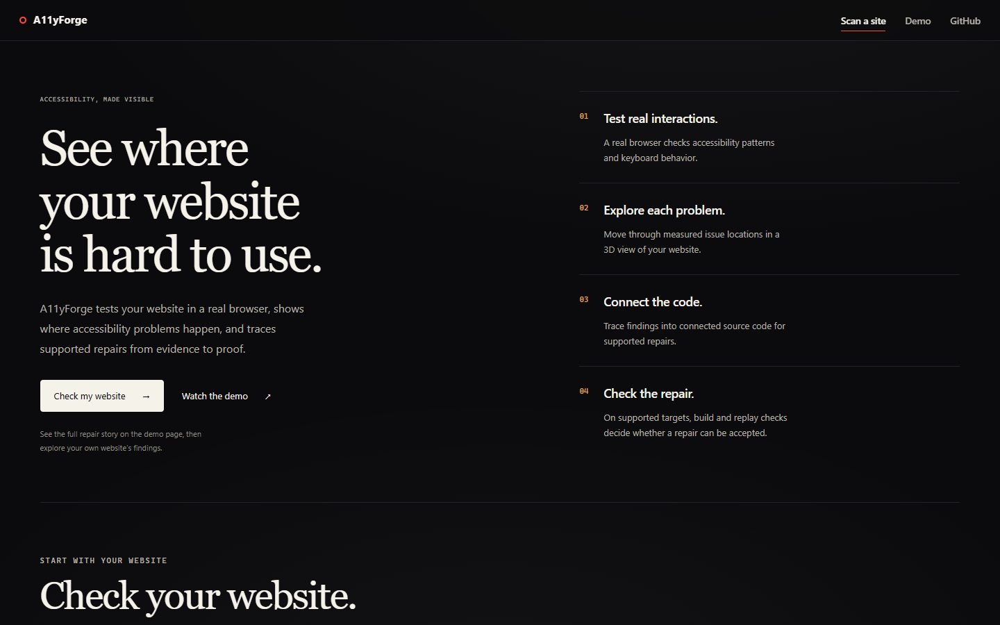

**Check my website** moves to the address field, and **Watch the demo** opens the recorded repair. Four
short steps explain the product: test real interactions, explore each problem, connect the code, and
check the repair.

### Checking a website

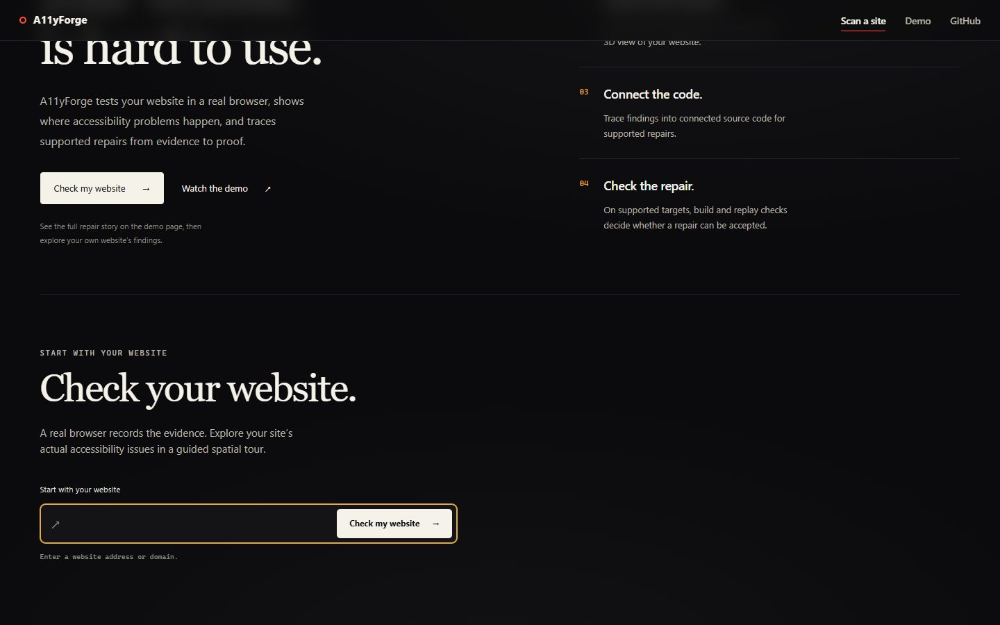

Type a website address or domain and press **Check my website** or Enter. While you type, the field
shows one amber outline. When you tab to the button, the button shows its own white ring.

An address that can't be understood shows the problem under the field, and no scan starts:

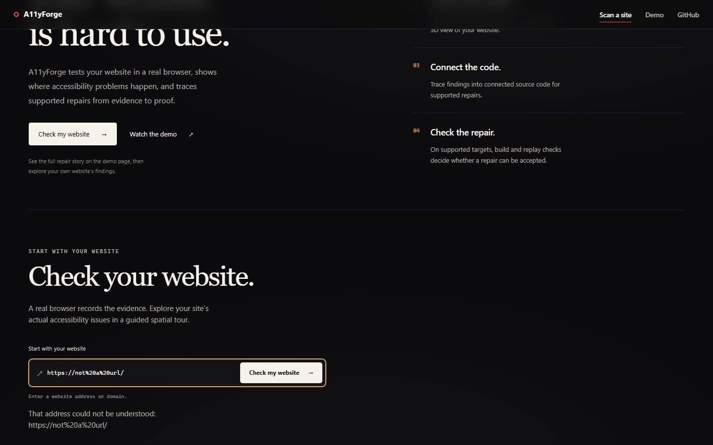

Private, loopback, link-local and reserved addresses are refused on a public server.

## The scan

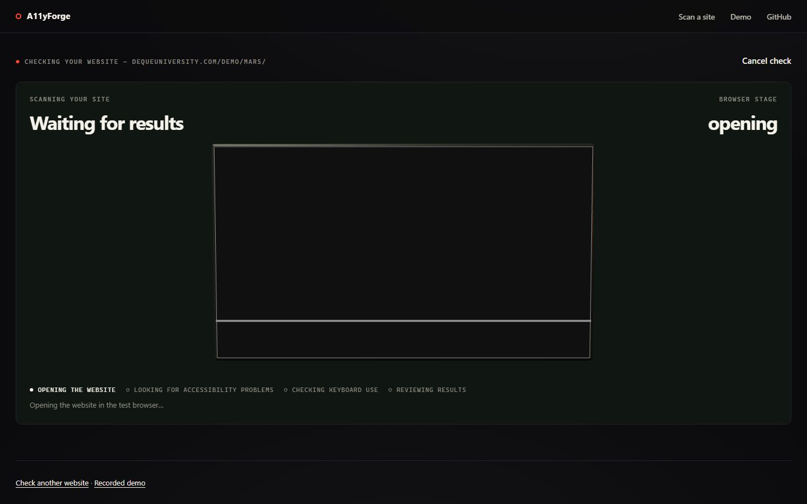

A real Chromium browser opens the site. The page shows real progress through four stages: opening the
website, looking for accessibility problems, checking keyboard use, and reviewing results. **Cancel
check** stops it. Scanning makes zero model calls.

By default a scan covers up to 3 pages and 8 screenshots, within 120 seconds. When it finishes, the
tour opens on its own. Results keep their own address, so you can refresh or share the link.

## The 3D tour

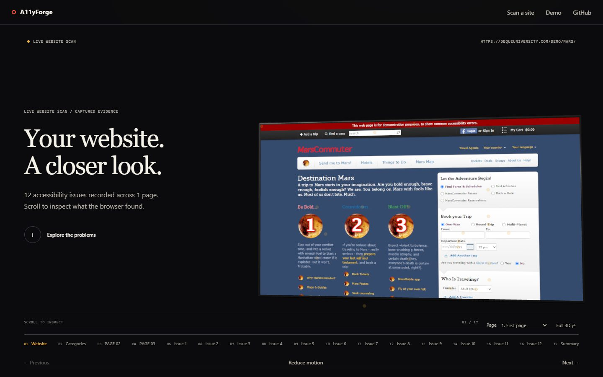

The tour is built only from this scan's screenshots and measurements. Scroll, or use **Previous**,
**Next** or the chapter strip, to move through it.

| Control | What it does |
| --- | --- |
| Chapter strip | Jumps to the website, categories, each captured page, each issue or the summary |
| **Page** list | Jumps between captured pages, when there is more than one |
| **Full 3D** / **Lightweight 3D** | Switches between the full scene and a lighter one |
| **Reduce motion** | Removes the camera movement. It's already on if your system asks for reduced motion |
| **Skip spatial tour** | Moves past the tour for keyboard and screen-reader users |

### Categories

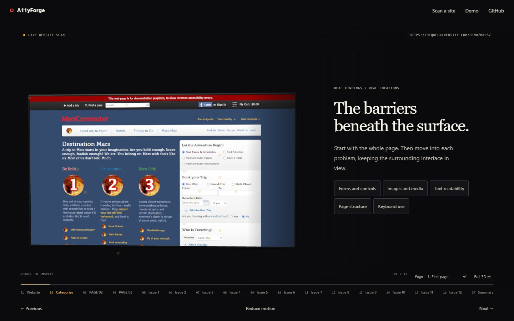

Problems are grouped by what they affect: forms and controls, images and media, text readability, page
structure, and keyboard use.

### Each issue

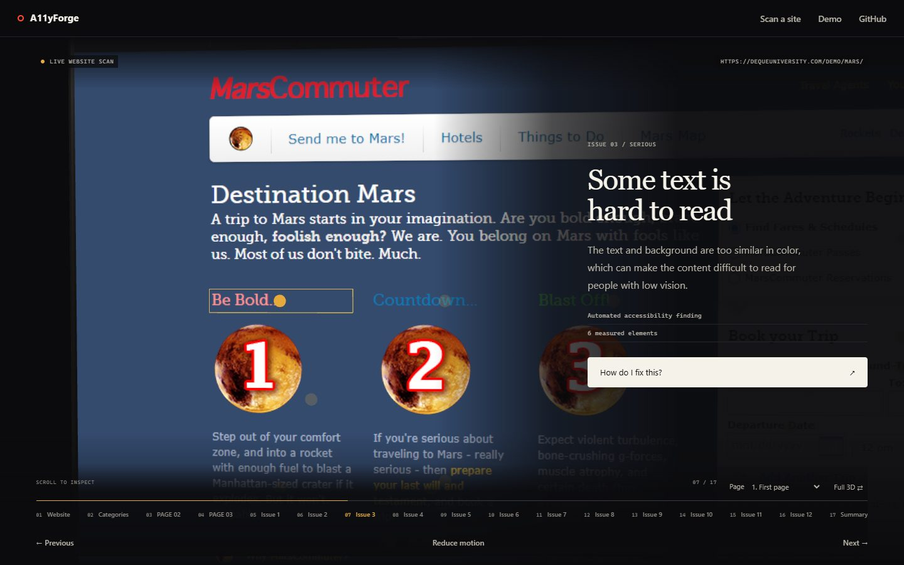

Each issue is explained in plain language, with its severity and how it was found. The camera moves to
the problem's measured location on the real page. If a location couldn't be measured, none is drawn.
**How do I fix this?** opens the source connection for that issue.

### Pages that couldn't be tested

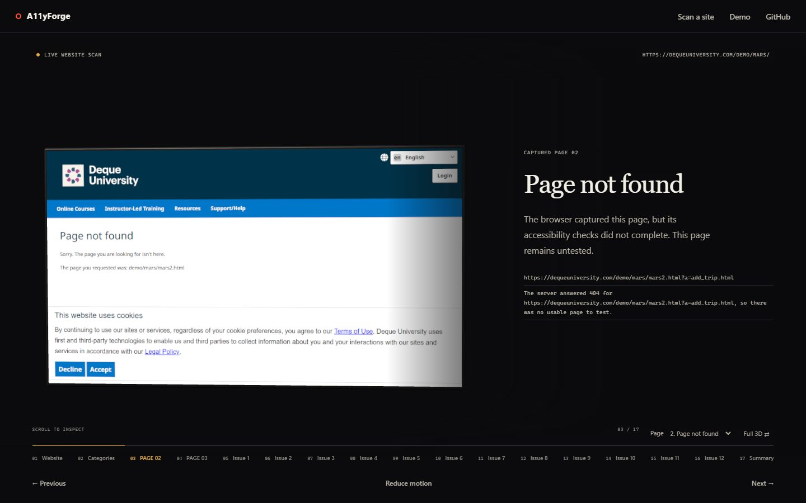

A page that couldn't be tested stays labeled as untested, with the reason, and never counts as passing.
In this scan, two linked pages answered 404. Sign-in walls, CAPTCHA and bot protection can also limit
what gets tested.

## Full results

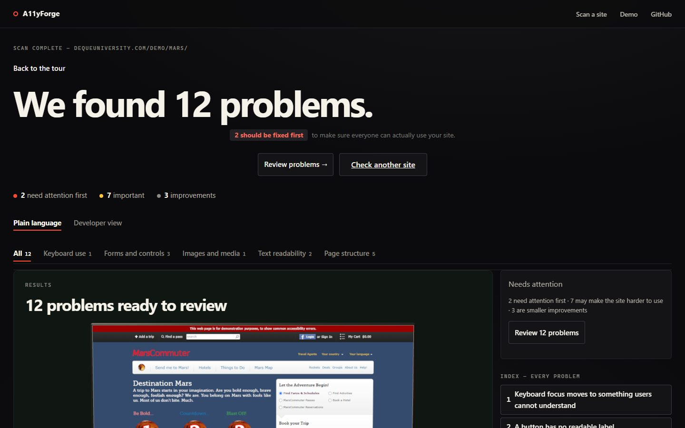

**Developer details and full evidence**, at the end of the tour, opens the complete results.
**Back to the tour** returns to it.

- A count of problems by priority: need attention first, important, and improvements
- A **Plain language** and a **Developer view**, with filters by category
- An index of every problem, including those with no measured location
- **What we couldn't check**, listing each limit of the scan

## Connect code

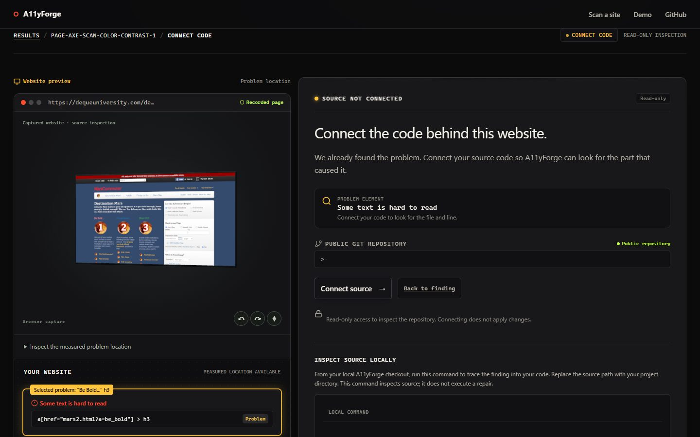

This page traces one problem into the code behind the website. It only reads the repository: it runs
none of its code and applies no changes.

1. Enter a public Git repository address, then press **Connect source**.
2. A11yForge makes a shallow clone with hooks turned off, and searches using identifiers from the
   evidence.
3. It shows ranked candidate files and code snippets, with the reasons for each ranking.

A match is a candidate, not proof of the cause, and when matches are ambiguous the page says so. For
source on your own computer, the page gives a command to run from a local checkout, and that command
also only inspects.

## The demo

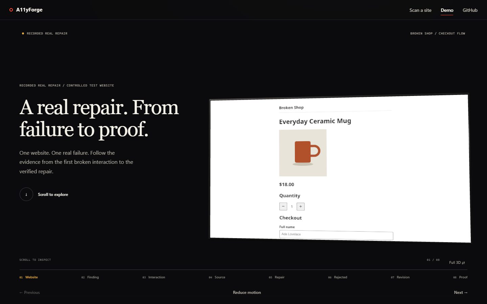

The demo replays a real repair recorded on 26 October 2026 against the controlled Broken Shop target,
run `2026-10-26T19-04-29-541Z-27affb`. It uses `muse-spark-1.3-contributor`, makes no model calls when
you watch it, and is labeled as recorded throughout. It is not a live repair of any scanned website.

| Chapter | What it shows |
| --- | --- |
| Website, Finding | The controlled target and the recorded failure |
| Interaction | The recorded Tab sequence: focus leaves the open dialog |
| Source | The code traced from the evidence |
| Repair | The first Meta repair. Browser behavior improved |
| Rejected | Strict TypeScript failed, so A11yForge rejected its own repair |
| Revision | The compiler output became evidence for one bounded revision |
| Proof | Typecheck, build, original replay and reverse replay passed, and the critic accepted |

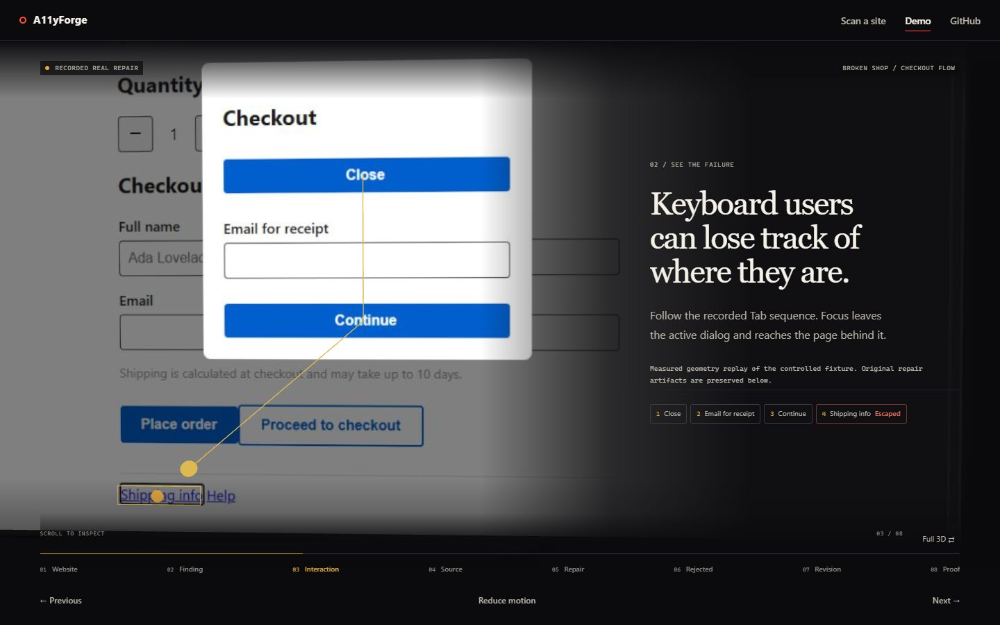

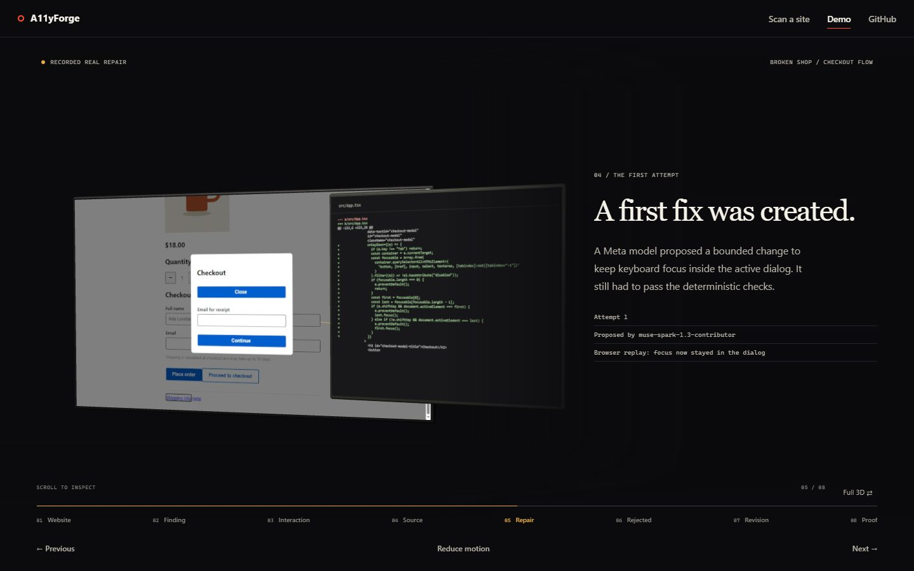

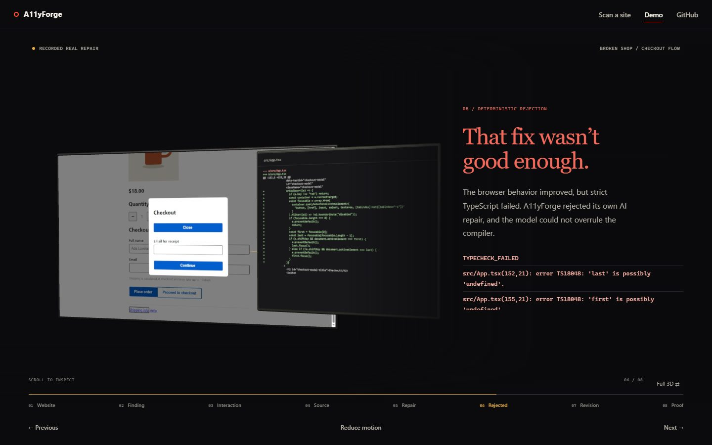

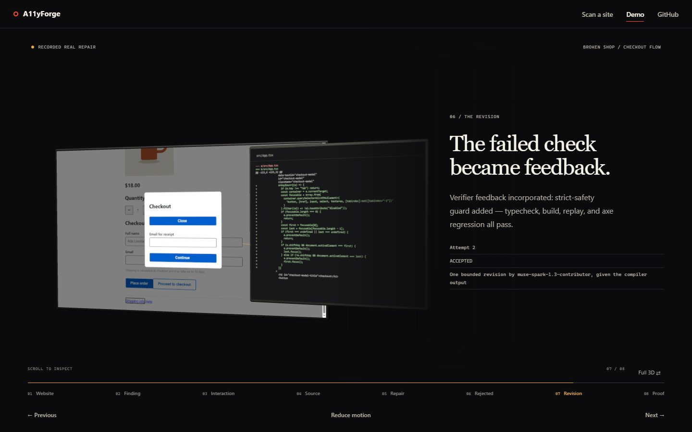

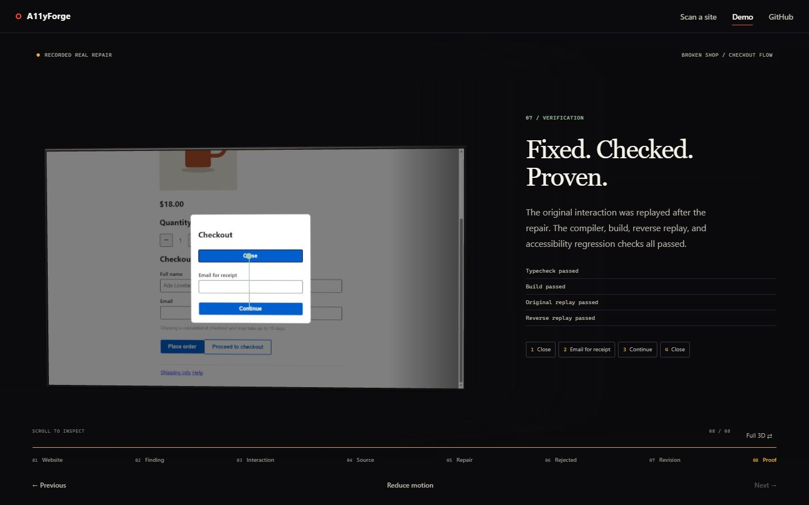

Below the tour, you can check your own website. **Developer details** opens the original artifacts: the
pipeline record, browser events, before and after, diagnosis, source trace, patches, verification
results and real model usage.

### Live runs

Also in Developer details, **Run a live repair on the controlled fixture** starts a real run, but only
when the server has a model key. Without one, the page says live execution is unavailable and the API
answers 503. A run can make up to 4 paid model calls. If the operator sets a passcode, the page asks for
it, and the page shows how many runs remain that day.

Live repair works only on the controlled fixture. Repair of arbitrary websites isn't available.

## Accessibility of the site

| Situation | What the site does |
| --- | --- |
| Keyboard only | Skip links, a visible focus indicator, and full tour navigation |
| Reduced motion | Follows the system setting, and also has its own toggle |
| WebGL unavailable | Falls back to a tour without the 3D scene |
| Phone or tablet | Layouts for phone, tablet and landscape, with touch-sized controls |

| Phone: home | Phone: tour |
| --- | --- |
| 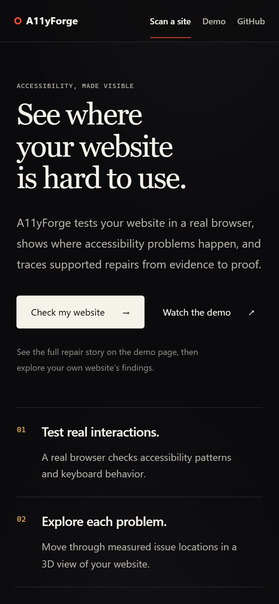 | 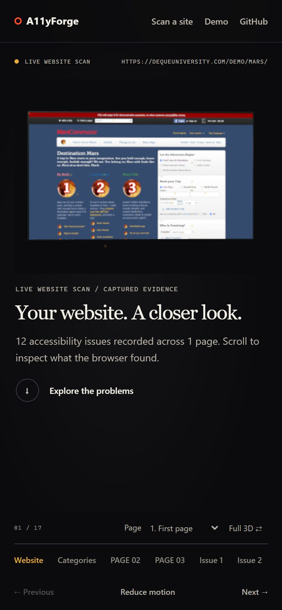 |

These were tested in browser viewports and simulated conditions, not on physical phones.

## Reference for developers

### API

The API sits behind the web app at `/backend` on a one-port deployment.

| Method and path | Purpose |
| --- | --- |
| `GET /health` | Status, model configured or not, passcode required, runs left today |
| `POST /explorations` | Start a scan with `url`, and optionally `maxPages` from 1 to 25 |
| `GET /explorations/:runId` | Scan state and results |
| `GET /explorations/:runId/events` | Scan progress as server-sent events |
| `POST /explorations/:runId/cancel` | Cancel a scan |
| `GET /explorations/:runId/screenshots/:name` | A scan's screenshot |
| `POST /sources/connect` | Connect a public Git repository. Local paths are refused |
| `GET /sources/:sourceId` | Connection state |
| `GET /sources/:sourceId/trace` | Ranked source candidates |
| `GET /sources/:sourceId/patch` | Patch state for a connection |
| `GET /runs`, `GET /runs/demo`, `GET /runs/:runId` | Repair runs and the recorded demo |
| `GET /runs/:runId/artifacts/:name` | A run's artifact |
| `POST /runs` | Start a paid live repair of the controlled fixture |
| `GET /runs/:runId/status`, `GET /runs/:runId/events` | Live run state and progress |

### Limits

| Limit | Default | Setting |
| --- | --- | --- |
| Scans running at once | 3 | Fixed |
| Repository connections at once | 3 | Fixed |
| Scans per client, per hour | 10 | `A11YFORGE_SCANS_PER_HOUR_PER_CLIENT` |
| Connections per client, per hour | 10 | `A11YFORGE_SOURCES_PER_HOUR_PER_CLIENT` |
| Live runs per client, per hour | 2 | `A11YFORGE_RUNS_PER_HOUR_PER_CLIENT` |
| Live runs per day, all clients | 20 | `A11YFORGE_MAX_RUNS_PER_DAY` |
| Model calls per live run | 4 | Fixed |

### Configuration

Every setting is in [`.env.example`](../.env.example). The main ones:

| Setting | Purpose |
| --- | --- |
| `MODEL_API_KEY` | Server-side model key. Without it, live runs answer 503 |
| `MODEL_BASE_URL` | An OpenAI-compatible HTTPS endpoint. Default: `https://api.meta.ai/v1` |
| `A11YFORGE_META_MODEL` | The model. Default: `muse-spark-1.3-contributor` |
| `A11YFORGE_RUN_PASSCODE` | Passcode for live runs on a public host |
| `A11YFORGE_ALLOW_PRIVATE_TARGETS` | Allows private targets for local development. Leave unset on a public host |
| `A11YFORGE_DATA_DIR` | Where scan results and live run artifacts are stored |

See [deployment](DEPLOYMENT.md) for hosting and security, and [the README](../README.md#run-locally)
to run it locally.

## What the site does not do

- It doesn't repair arbitrary websites. The repair loop runs on the controlled fixture.
- A scan isn't a full conformance audit, and a verified repair proves the tested behavior only.
- It doesn't test behind sign-in, CAPTCHA or bot protection. Those limits are reported.
- It has no user accounts, and anyone with a scan's address can open its results.
